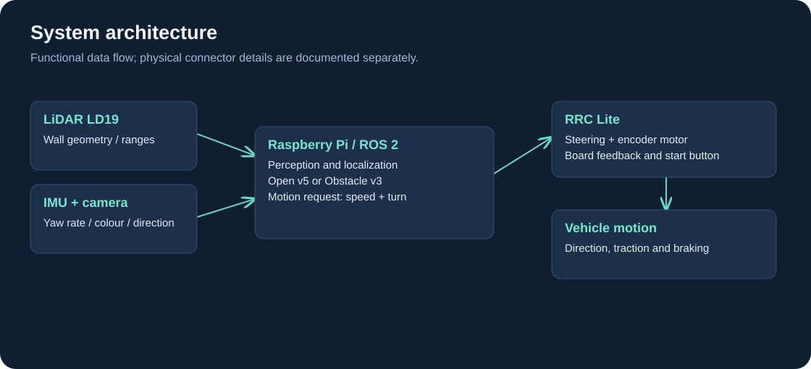
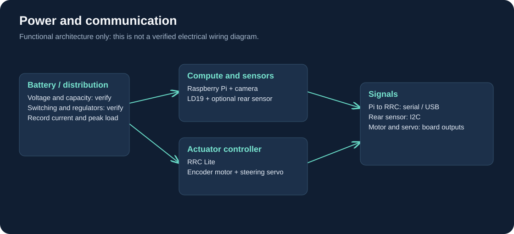
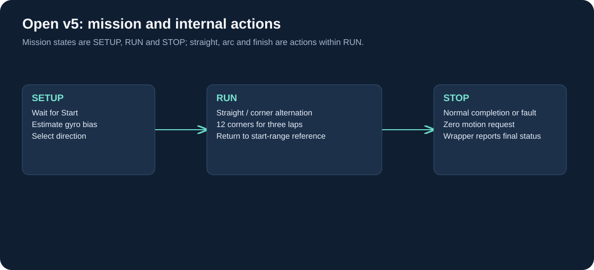
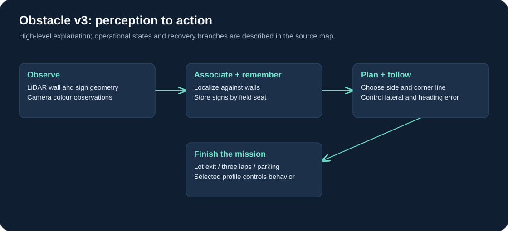

<p align="center"></p>

<p align="center"><strong>Design · Sense · Decide · Drive · Learn</strong></p>
<p align="center"><a href="#the-vehicle">Vehicle</a> · <a href="#mechanical-design">Mechanics</a> · <a href="#power-and-sensing">Electronics</a> · <a href="#software-and-strategy">Strategy</a> · <a href="#reproduce-the-system">Build and run</a> · <a href="docs/09-evaluation-guide.md">Judge's guide</a></p>

# Renkay — WRO 2026 Future Engineers

Sami is the autonomous vehicle documented by Renkay, part of Robotek Perú. Our previous repository records a project developed through successive mechanical, electronic and software revisions. This edition brings the current coach reference into a single engineering narrative: how the car moves, what it can observe, how its software chooses a maneuver and how those decisions can be tested.

The engineering baseline is the coach's `robotek-learn` revision `c5de794342b5da46725ba9a6994fb73bbebd0ff0`. It includes the Open v5 and Obstacle v3 strategies, hardware adapters, simulation packages and tests. The team's clarification is reflected throughout: the earlier external motor driver has been replaced by an encoder motor controlled through the HiWonder RRC Lite. The encoder measures rotation; the board provides the motor's power control.

Team and vehicle names are carried forward from the team's previous documentation. The names, photographs and measurements that change between seasons must be confirmed for the submitted vehicle. The [evidence register](docs/10-evidence-register.md) makes that distinction explicit without interrupting the technical explanations.

## Explore the project

| What you want to understand | Read |
|---|---|
| Vehicle layout, steering and drivetrain | [Mechanical design](docs/01-mechanical-design.md) |
| Power architecture, sensors and their limitations | [Power and sensing](docs/02-power-and-sensing.md) |
| ROS packages, messages and hardware interfaces | [Software architecture](docs/03-software-architecture.md) |
| Three laps without traffic signs | [Open challenge](docs/04-open-challenge.md) |
| Traffic signs, corners and parking | [Obstacle challenge](docs/05-obstacle-challenge.md) |
| Why the design changed | [Engineering decisions](docs/06-engineering-decisions.md) |
| Assembly, installation and calibration | [Reproduction guide](docs/07-reproduction.md) |
| Test procedures and interpretation | [Testing and results](docs/08-testing-and-results.md) |
| Evidence for each rubric criterion | [Evaluation guide](docs/09-evaluation-guide.md) |
| Team, provenance and reference practices | [Team](docs/11-team.md) · [References](docs/12-references.md) |

## The vehicle

Sami uses an Ackermann-type front steering mechanism and a driven axle. A Raspberry Pi runs the perception and strategy software; a RRC Lite connects that software to the motor, steering servo and board feedback. A LD19 LiDAR observes the surrounding geometry, the IMU supplies angular-rate measurements and the camera contributes colour information. These sensors have complementary roles: a range measurement can locate an object without identifying its colour, while a colour observation alone does not supply reliable metric clearance.



| Subsystem | Current reference | Engineering role |
|---|---|---|
| Compute | Raspberry Pi 5, Ubuntu 24.04, ROS 2 Jazzy | Sensor processing and mission execution |
| Motor interface | RRC Lite, motor port M2 | Board-controlled encoder motor |
| Drive motor | JGA27-310R, 20:1 gearbox, as identified in the coach configuration | Traction; actual speed depends on gearing and load |
| Transmission | Latest baseline calibration identifies external 1:1 gears | Couples the motor output to the driven axle |
| Steering | Servo with measured centre and asymmetric angle mapping | Converts steering requests into wheel angles |
| LiDAR | LDROBOT LD19 | Walls, free space and candidate signs |
| Camera | IMX708 Wide car profile | Direction cues and traffic-sign colour |
| IMU | RRC Lite IMU transformed to the vehicle frame | Relative heading and turning feedback |
| Rear range | VL53L0X support in the hardware package | Additional rear-distance feedback where installed |

The values above identify the source baseline. A procurement-ready component inventory and the final physical configuration are tracked in [the bill of materials](other/bom.csv) and [the evidence register](docs/10-evidence-register.md).

## Mechanical design

The front wheels steer while the drivetrain supplies longitudinal motion. This keeps the software's steering request separate from its speed request, but also creates a minimum turning radius. The bicycle model used by the software relates wheelbase L, steering angle δ, speed v and yaw rate ω through `ω = v tan(δ) / L`. It is a planning approximation: tyre slip, servo delay and linkage compliance affect the real path.

The hardware configuration uses a 0.1174 m wheelbase and a 19° effective wheel-angle limit. Those values imply an ideal centreline turning radius near 0.34 m. This is a calculation, not a measured clearance guarantee. Obstacle v3 retains its own 0.11883 m planning geometry because its corner table was computed with that model. The distinction and its consequences are explained in [mechanical design](docs/01-mechanical-design.md).

Changing the motor, gearing or steering centre changes the behavior of both challenges. The repository therefore keeps calibration profiles next to their implementation and separates historical parameters from current launch choices. Fabrication assets are indexed in [models](models/README.md); simulation meshes are clearly identified as simulation assets rather than editable manufacturing CAD.

## Power and sensing

The compute, sensing and actuator paths have different electrical demands. Motor starting and steering loads can produce peaks that are not represented by an idle current reading. The power budget consequently separates rails, typical consumption, peak consumption and regulator losses. Battery-side demand is calculated from power, not by adding currents measured at different voltages.



The LiDAR scan adapter removes points outside the usable field of view and applies the car-frame convention. The current hardware configuration sets zero bearing forward, uses a ±110° useful field and rejects returns nearer than 0.12 m. Those values address the mounting and chassis occlusion recorded in the baseline. The IMU adapter maps the board axes to forward, left and up; this is essential because a physically rotated board must not be interpreted as if it lay flat.

The camera configuration is specific to the selected driver. The IMX708 Wide Obstacle profile uses a 1.78 rad horizontal field of view and calibrated pitch/yaw. The USB-camera correction in `robot.yaml` describes a different image path. Combining their calibration values would produce inconsistent bearings. The [sensor chapter](docs/02-power-and-sensing.md) explains which values belong together.

## Software and strategy

The source tree contains ROS 2 packages rather than a single monolithic driving script. Sensor drivers acquire data; adapters express that data in the vehicle frame; strategy packages choose motion; the base adapter converts motion to board commands. Package responsibility and topic names are indexed in [the software chapter](docs/03-software-architecture.md).

### Open challenge

Open v5 estimates gyro bias after Start, selects the driving direction and alternates straights with corner arcs. It integrates yaw rate and corrects heading against suitable island-wall observations on straights. Straight progress comes from the changing front-wall range. The presence of a motor encoder does not mean this strategy localizes itself by integrating wheel revolutions.



Corners require multiple conditions: sufficient travel since the previous turn, a front wall within the turning threshold and an island end that has opened or been confirmed in successive scans. The look-ahead is limited near the island to reduce early turns into the inner wall. The finish compares front range against the recorded starting reference after the required corner count. [Read the algorithm and control equations](docs/04-open-challenge.md).

### Obstacle challenge

Obstacle v3 localizes against the field walls, groups LiDAR returns into candidate signs and associates those observations with camera colours. It remembers signs by their field seats, chooses the correct passing side and constructs a line and corner maneuver with clearance in mind. Red signs are passed on the right and green signs on the left.



Parking behavior depends on the selected profile. The source includes a search-based parking mode, a fixed maneuver mode and a car round profile with partial parking and calibrated finish pulses. This repository describes those alternatives explicitly; the round profile's pulses should not be presented as a general geometric planner. [Read the parking and recovery explanation](docs/05-obstacle-challenge.md).

## Engineering decisions

The project history is useful when it explains a trade-off. Moving to the RRC encoder-motor interface changes the command path and the calibration problem. A steering lookup table addresses a non-linear and asymmetric linkage. Correcting gyro drift with wall observations combines a short-term motion sensor with an external reference. These decisions are connected to code and baseline observations in [the engineering chapter](docs/06-engineering-decisions.md).

Some source configurations intentionally disable protections or diagnostics, including the forward wall guard and Open crash detection. Their presence in the code does not imply that they are active. The failure register distinguishes detection, warning, stopping behavior and unverified assumptions.

## Reproduce the system

Read [assembly, installation and calibration](docs/07-reproduction.md) before operation. The hardware target is Ubuntu 24.04 arm64 on the Raspberry Pi, with ROS 2 Jazzy. Windows can be used to edit and upload the documentation; it is not the native execution environment for the car.

From the repository root on the supported Pi:

```bash
bash tools/setup-pi.sh --dry-run
bash tools/setup-pi.sh
source /opt/ros/jazzy/setup.bash
colcon build --symlink-install
source install/setup.bash
bash tools/setup-pi.sh --check
```

The setup script installs software and configures the computer. Read its output, complete any requested logout/login for device groups, and verify sensor axes and actuator direction with the car supported before a field run.

Select one strategy at a time:

```bash
bash tools/car-run.sh open
# Alternative challenge:
bash tools/car-run.sh obstacle
```

The default Obstacle command alone does not establish that full-round parking is enabled. The reproduction guide gives the profile path and explains the additional car-specific arguments. The hardware button controls Start; stopping behavior and the launch wrapper are described before the operating procedure.

## Testing and performance

The supplied source contains inherited tests and experimental notes. Those records remain attributed to their original source and conditions. This rebuild has not run the vehicle or produced new physical performance measurements. We do not infer a final success rate from a single successful run or from simulated scoring.

Our [test protocols](docs/08-testing-and-results.md) specify direction, layout, hardware revision, code revision, parameters, battery and observable outcomes. Blank result tables are evidence capture tools, not reported results. Team photographs, current six-view vehicle images and challenge videos are indexed in [team photos](t-photos/README.md), [vehicle photos](v-photos/README.md) and [performance videos](video/video.md).

## Repository map

```text
README.md               Project narrative and technical overview
docs/                   Design, strategies, reproduction and evidence
assets/                 Original vector diagrams
src/                    Coach-derived ROS packages and package tests
tools/                  Setup, launch and calibration utilities
models/                 Manufacturing status and simulation mesh index
schemes/                Functional architecture and connection register
t-photos/ · v-photos/    Team and current vehicle image indexes
video/                  Challenge video register
other/                  BOM, power budget, calibration and test records
```

## Credits and development status

Code and calibration baseline: Renzo Damian and Robotek, with LDROBOT and HiWonder-derived components credited in [CREDITS.md](CREDITS.md). The [provenance manifest](PROVENANCE.md) records the exact source revision, the material retained and the language-only changes to vendor comments and one diagnostic message. The original component licenses and notices remain included.

This repository contains a developed technical explanation, runnable-source baseline and defined evidence workflow. Final physical evidence still depends on the documented vehicle: exact current wiring, editable fabrication CAD, current photographs, videos and measured trials. Their status is listed once in [the evidence register](docs/10-evidence-register.md). [The evaluation guide](docs/09-evaluation-guide.md) maps the documentation to the supplied five-criterion 2026 rubric.
