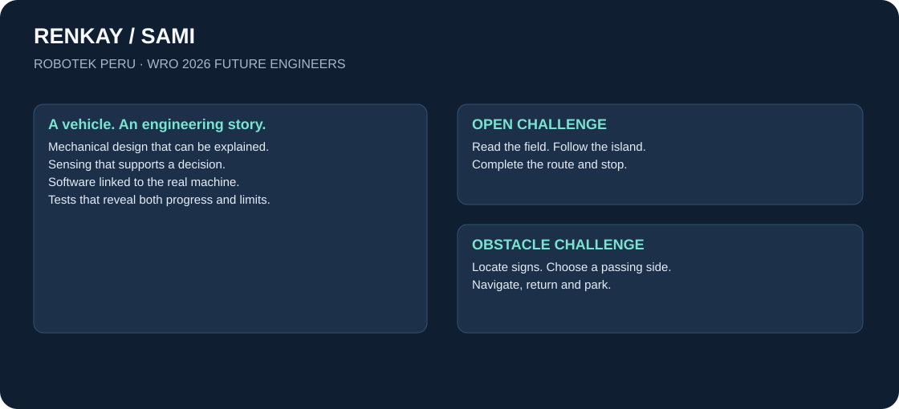

# Renkay · Sami at WRO 2026

## Meet Renkay and Sami

Sami is the autonomous car developed by Renkay at Robotek Perú. The name Renkay connects persistence, collective work and growth. The [team archive and credits](CREDITS.md) identify the people behind earlier builds, the coach’s software baseline and the origins of the hardware packages.

### About the challenge

The World Robot Olympiad is an international robotics competition. In the 2026 Future Engineers self-driving cars challenge, a vehicle must drive autonomously in two events. Open tests navigation around a changing track. Obstacle adds traffic signs, passing-side decisions and parking. A useful design for Sami therefore has to negotiate corners at speed and still move predictably during a slow parking manoeuvre.

[Vehicle history](docs/01-vehicle-design-history.md) · [Build guide](docs/09-build-and-run.md) · [Performance video register](video/video.md)

## From cardboard to competition

The first prototype let the team move the steering linkage by hand and explore where the electronics would fit. By V8, fitting that same mechanism inside a narrow chassis had become a real packaging problem. Slimmer front wheels and a vertical servo freed space. On V9 the team moved the rack after it contacted the servo. A change that looks small from above determines how far the wheels can actually turn.

 

*Archived team photographs: V1 (left) and V9 (right).*

The [illustrated history](docs/01-vehicle-design-history.md) follows all eleven labelled builds in the earlier team record, including the change in wheel height that brought the walls back into the LiDAR scan. The current reference uses the HiWonder encoder motor through RRC Lite. The exact build installed on the competition Pi still needs a dated deployment record.

## Vehicle design and electronics

Sami uses a driven axle and Ackermann-type front steering. During a turn, the inside wheel follows a smaller circle than the outside wheel. The linkage permits different wheel angles from a single servo input. The controller approximates their shared path using one equivalent angle. On the physical car, linkage clearance and tyre grip determine the envelope swept by the body. The [mechanical chapter](docs/02-mobility-and-mechanical-design.md) connects gear selection, steering travel and wheelbase to the model and the tests needed to check it.

The Raspberry Pi runs the strategies. The RRC Lite supplies the motor command on M2 and sends steering pulses to the servo. The encoder measures rotation. For the reference strategies, wall ranges and inertial readings supply the navigation information. The LD19 observes wall geometry, the IMU observes turning motion, and the camera supplies colour cues. The usefulness of each reading depends on mounting height, orientation and which part of the field is visible. [Power paths and sensor placement](docs/03-power-and-sensor-architecture.md) · [Connection register](schemes/connections.csv)

## How the software works


| Package | Connection to the vehicle |
|---|---|
| robotek_hardware | Applies the sensor mounting conventions and maps requested motion to board commands. |
| robotek_open | Uses wall geometry and heading to select a straight, a corner arc or the finish. |
| robotek_obstacle_v3 | Associates a camera colour with a candidate seen by LiDAR and plans how to pass it. |
| robotek_course | Starts the selected stack and applies the launch configuration. |

For example, when Sami approaches a sign, a range cluster gives the planner a candidate position. Colour and bearing help associate a camera observation with that candidate. The selected passing side then affects the target line, the steering request and finally the servo command. [Architecture and data flow](docs/04-software-architecture.md) · [Jump to code](src/README.md)

## Open and Obstacle challenges

**Open.** The car estimates gyro bias at startup and selects the driving direction. On a straight it checks heading against the island wall. At a corner it considers both the wall ahead and the opening beside the island before committing to the turn. After twelve corners it uses the range recorded at the start as a reference for stopping. [Open strategy](docs/05-open-challenge.md)

**Obstacle and parking.** The car remembers signs by their places on the field. It passes red on the right and green on the left, then returns to a trajectory that leaves space for the next corner. Parking depends on the selected profile. The supplied round profile combines a partial fixed manoeuvre with a sequence of finishing pulses. [Obstacle and parking](docs/06-obstacle-challenge-and-parking.md) · [Video register](video/video.md)

## What we tested and learned

| Team archive observation | Design consequence |
|---|---|
| The scan plane on an early build missed the walls. | V6 changed wheel height. The current calibration procedure checks the scan against a wall at actual ride height. |
| V9’s steering rack contacted the servo in the preceding layout. | The team repositioned the mechanism. Turning tests must check both sides of the assembled car. |
| V11 encountered colour variation under room lights. | The team introduced local illumination. The proposed vision trial records both colour errors and incorrect sign associations. |

These observations belong to the archived builds. Current parking repeatability, turning clearance and battery runtime need new measurements tied to the deployed profile. [Calibration procedures](docs/07-calibration.md) · [Testing protocols and results](docs/08-testing-and-results.md)

## Build and run

The target is a Raspberry Pi 5 running Ubuntu 24.04 arm64 and ROS 2 Jazzy. From the repository root on the Pi, review the setup plan, install dependencies, build the workspace and check device access:

```bash
bash tools/setup-pi.sh --dry-run
bash tools/setup-pi.sh
source /opt/ros/jazzy/setup.bash
colcon build --symlink-install
source install/setup.bash
bash tools/setup-pi.sh --check
```

Choose one challenge after checking neutral, steering direction and sensor orientation. Start Open with `bash tools/car-run.sh open` or select Obstacle with `bash tools/car-run.sh obstacle`. Use the [assembly and launch guide](docs/09-build-and-run.md) for the round-specific parking arguments, hardware Start button and first-run checks.

## Next steps and credits

Measure the body’s turning envelope in both directions, then check parking across starting positions and battery levels. These observations will determine how much clearance the planner should allow. The [future-work chapter](docs/10-recommendations-and-future-work.md) ties each proposal to a measurable outcome.

[Models](models/README.md) · [Wiring](schemes/README.md) · [Materials and records](other/README.md) · [Team photo](t-photos/README.md) · [Vehicle views](v-photos/README.md) · [Credits](CREDITS.md) · [Submission evidence](other/submission-guide.md)
