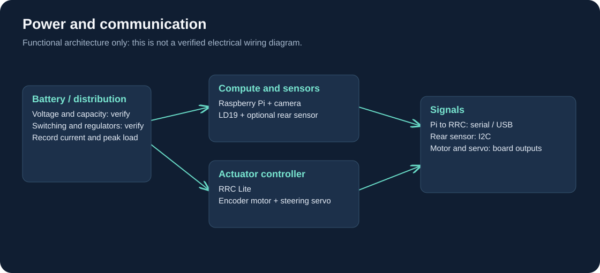

# Power and sensor architecture

[Mechanics](02-mobility-and-mechanical-design.md) · [Software](04-software-architecture.md)

## Power paths and limits of the available evidence

The reference architecture contains a battery-powered actuator controller and a Raspberry Pi with sensing peripherals. The historical team documentation describes a 7.4 V battery, but its wiring mixes older motor-driver configurations. It cannot establish the present battery chemistry, capacity, regulator models or exact wiring by itself. The diagram below is consequently a functional power/signal overview, not a pin-level construction drawing.

The current command path uses RRC Lite for the encoder motor. L298N and TB6612 descriptions belong to previous assemblies. Driver software for the LiDAR and control board is still required; the word “driver” can describe software or motor-power electronics, so those meanings are distinguished throughout this repository.

## Budgeting power correctly

For each load, power is `P = V × I`. For a regulated rail with efficiency η, battery-side demand is approximately `P_in = P_out / η`. Sum loads as watts at their respective rails, account for losses, and only then convert to battery current using the relevant battery voltage. Summing a 5 V load's amperes with an actuator rail's amperes does not yield battery current.

Estimated runtime is `t ≈ E_usable / P_average`. Usable energy is lower than a simple nominal voltage-capacity product when discharge limits, regulator cutoffs, load peaks and pack behavior matter. Measure a complete representative session rather than reporting an ideal estimate as real autonomy. Peak capacity is checked separately from average runtime: a regulator can have an acceptable average load and still fail during motor/servo transients.

The [power-budget register](../other/power-budget.csv) identifies rail, typical/peak current, measurement conditions and evidence. No fabricated current readings or battery capacity are inserted. This follows the useful method of separating supply-side and load-side reasoning seen in Double X's documentation, without importing their different components or numbers.

## LiDAR: geometry before interpretation

The LD19 supplies angular range observations. The adapter standardizes orientation and discards unusable returns. In the current robot.yaml, `angle_offset = 0`, `reverse = false`, `fov_deg = 110` and `min_valid_range = 0.12`. Historical text describing zero pointing backwards is superseded by this current configuration.

The ±110° crop reflects the reference car's own body occlusion. Losing rearward observations is a physical mounting consequence, not simply a software filter choice. Wall fitting needs enough observations of actual walls; short clusters may be traffic signs, body reflections or other artifacts. Different stages of the strategy treat those groups differently.

Validate a box directly ahead, then left and right, and compare known distances at multiple bearings. Record rejected near returns and blind sectors. At speed v with latency Δt, the car moves `v × Δt` before reacting; total stopping margin must include that distance as well as mechanical braking.

## IMU: local heading with an external correction

The board is mounted on its edge. The current mapping is forward = -board x, left = +board z, up = +board y. Gyro bias is estimated with the vehicle stationary after Start. Open integrates angular rate for heading and corrects suitable straight-wall discrepancies; this limits accumulated error without pretending the gyro is drift-free.

A mounting change invalidates the axis mapping. Verify the sign of a hand-turned left rotation and confirm gravity lies on the expected axis. A bias measured while moving is not a valid stationary calibration. The source's wall-heading correction also rejects large discrepancies so that a bad wall fit is not automatically interpreted as drift.

## Camera: match calibration to the image path

The selected real-car driver defaults to the IMX708 Wide path. The Obstacle profile contains `camera_hfov = 1.78 rad`, `camera_pitch = 0.14 rad` and `camera_yaw = 0.054 rad`. Red uses a hue range that wraps the hue boundary; green uses its own saturation/value thresholds. These thresholds distinguish coloured pillars from darker floor lines under the recorded conditions.

The USB publisher has a separate rotation, undistortion and crop configuration in robot.yaml. Those settings must not be substituted for the Wide-camera profile just because both sources contain a field-of-view number. Verify the complete driver → image dimensions → optical calibration → colour thresholds chain.

Changes in lighting, glare and white balance can change colour reliability. Record a labelled set with red, green, floor lines and background; measure false detections and missed colours under multiple lighting conditions. The strategy associates colour with LiDAR geometry, but a wrong association remains possible if bearings or timing are inconsistent.

## Encoder and rear range

The encoder supplies motor-rotation feedback to the controller. It is not the Open strategy's distance source and does not itself detect tyre slip. The software's board rps conversion is calibrated against actual motion.

VL53L0X rear-range support includes a measured correction table and reconnection logic. The driver reports both metric and millimetre topics. Its near-range uncertainty matters during parking; a corrected number is not proof that every surface has the same response. Record whether this sensor is physically installed and whether the selected strategy/profile actually uses its readings.

## Fault behavior

| Condition | Baseline behavior | Engineering consequence |
|---|---|---|
| Missing motion commands | Base-adapter watchdog | Stops requests after command loss; test actual motor response |
| Low board battery reading | Red warning after repeated low readings | Warning, not an automatic battery stop |
| Stale Obstacle sensors | Strategy waits rather than continues its normal line-following action | Recovery time affects mission completion |
| Forward wall guard | `wall_stop_m = 0` in the source configuration | Do not claim an active generic collision stop |
| Open crash detector | Disabled by selected profile | Crash recording/protection is optional, not always active |

Detailed physical connections are tracked in [schemes](../schemes/README.md). This chapter explains the architecture that the verified wiring drawing must implement.

## Design choices and trade-offs

### Encoder motor through RRC Lite

The previous documentation alternates between L298N and TB6612. The current source selects RRC motor control and M2. Consolidating motor control in the board changes the command interface from external PWM percentages to board speed requests. The encoder is feedback for that controller, while vehicle localization remains sensor/strategy-specific.

The practical trade-off is a more integrated interface with a board-specific motor/encoder model. The source records attempts involving motor types, signs and zero-speed behavior. The current configuration avoids sending a motor type and disables the earlier alternating-brake/reset workaround. A reproduction procedure must verify actual direction and stopping response rather than transplant an earlier motor-type setting.
