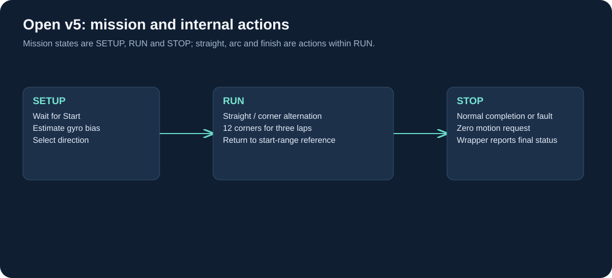

# Open challenge — from observations to three laps

## What is actually implemented

The included Open v5 is not the step-by-step `my_open` exercise. Its mission class exposes SETUP, RUN and STOP; straight following, corner arcs and finishing are internal RUN actions. Node-level status messages may use more detailed labels. A diagram that promotes every action into a mission state would misdescribe this implementation.

The main source is [v5/mission.py](../src/robotek_open/robotek_open/v5/mission.py); geometric observations come from [v5/scene.py](../src/robotek_open/robotek_open/v5/scene.py), and the selected car parameters are in [car_picam.yaml](../src/robotek_open/config/car_picam.yaml).

## Start and direction

After Start, SETUP gathers stationary gyro readings and finite front ranges. The gyro mean supplies a bias estimate; the median front range becomes the starting reference. Calibration is short, so moving the vehicle at this point contaminates both values.

Camera votes select clockwise or counterclockwise motion. The selected car profile allows a ccw fallback after the waiting interval rather than indefinitely requiring a camera vote. Before the first corner, the mission can reverse an incorrect initial direction if repeated LiDAR observations show the field opening on the other side. A direction timeout exists when no usable decision/fallback is available.

This design trades immediate progress against a potentially wrong initial assumption. Validation should therefore include ambiguous starting images and both track directions. A single correct fallback run does not prove that this branch works for every start location.

## Straight control

The mission integrates corrected gyro rate for yaw. A heading target is adjusted by a lateral bias derived from distance to the island. Steering combines heading error and yaw-rate damping:

`steer = clamp(KP × wrap(goal + lateral_bias − yaw) − DAMPING × gyro_rate)`.

This is proportional heading correction with rate damping and geometric lateral bias. It is not described as a full three-term PID controller. In a narrow corridor, preserving the requested island gap must not push the body into the outer wall; the implementation includes an outer-gap constraint.

On suitable straights the island wall gives an external heading reference. The correction is bounded, gated away from turns and applied once per new scan. This addresses gyro accumulation while rejecting grossly inconsistent wall fits. The car profile uses wall_heading_gain 0.3, rather than the disabled default found in other contexts.

## Corner detection and execution

A corner is armed only after sufficient post-turn travel. The front wall must also be near enough and the island end must be open or confirmed in successive scans. Requiring new scans prevents repeatedly evaluating one stale image of the world as multiple independent confirmations.

Look-ahead is `min(configured_lookahead, max(0, island_distance − clearance))`. Shortening it near the island reduces the risk of initiating a turn that cuts through the inner wall. During the arc the heading goal advances by a quarter turn and the car uses the configured corner speed and steering limit until the heading tolerance is reached.

The selected profile's cruise speed is 0.85 m/s, corner speed 0.64 m/s, turn tolerance 0.30 rad and brake margin 0.35 m. These are source requests, not fresh measurements. Increasing speed without checking LiDAR age, braking and steering response can invalidate the available corner margin.

## Lap counting and finishing

The mission's requested lap count determines its corner target: three laps correspond to twelve corners. Once those corners are completed, the finish routine uses the start-front-range reference and a finish lead rather than assuming that twelve turns automatically place the chassis in a legal final pose. It also considers heading and a stop wait.

The selected finish lead is 0.14 m and finish_speed is 0.32 m/s. Actual stopping position depends on the motor controller, command timing and traction. Measure the body position after settling, not just the moment the software publishes zero.

## Difficult cases and tests

| Case | Why it matters | Observation to record |
|---|---|---|
| Camera ambiguity | Fallback may initially select the wrong side | Initial vote, fallback flag, correction before first corner |
| Narrow corridor | A fixed island offset may leave too little outer clearance | Minimum outer gap and any contact |
| Intermittent LiDAR | Motion continues between observations | Scan ages, stopping/recovery, final trajectory |
| Heading drift | Errors accumulate across corners | Heading before and after each straight-wall correction |
| Different battery/load | Same board command may yield different physical speed | Time, braking distance and final stop position |

The current profile allows a scan age up to 1 s in its documented bridge logic and disables crash detection. Those choices are deployment trade-offs, not general guarantees. They should be assessed with recorded runs rather than silently carried forward as evidence of robustness.
