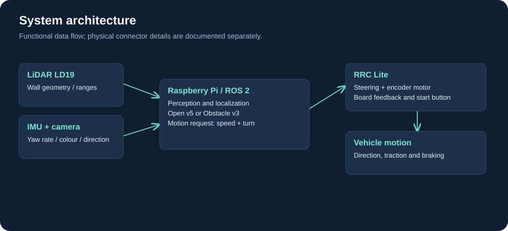

# Software architecture and interfaces

## Responsibility boundaries

The code separates sensing, coordinate conversion, mission logic and hardware actuation. A strategy should reason in vehicle-frame distances and angles rather than know a motor-port register or a raw board axis. The hardware adapter is the boundary where those high-level decisions become pulse widths and board motor commands.

| Package | Responsibility | Entry point or key source |
|---|---|---|
| robotek_open | Open v5 mission and ROS node | [v5/node.py](../src/robotek_open/robotek_open/v5/node.py) |
| robotek_obstacle_v3 | Sign-aware mission, planning, parking | [drive.py](../src/robotek_obstacle_v3/robotek_obstacle_v3/drive.py) |
| robotek_hardware | Sensor adapters, base adapter, board button and tools | [package](../src/robotek_hardware/package.xml) |
| robotek_common | Shared geometry and motion helpers | [vehicle.py](../src/robotek_common/robotek_common/vehicle.py) |
| robotek_course | Launch integration and course/base interfaces used by strategies | [car.launch.py](../src/robotek_course/launch/car.launch.py) |
| rrc_lite_driver / rrc_lite_msgs | Board transport and messages | [board notice](../src/rrc_lite_driver/NOTICE.md) |
| ldlidar_stl_ros2 | LD19 transport and scan publishing | [driver instructions](../src/ldlidar_stl_ros2/README.md) |
| robotek_description | URDF and simulation meshes | [package](../src/robotek_description/package.xml) |
| robotek_gazebo / robotek_evaluation | Simulation environment and evaluation support | [evaluation package](../src/robotek_evaluation/package.xml) |

## Data contracts

| Path | Meaning | Units / convention |
|---|---|---|
| LD19 → scan adapter → `/robotek/scan` | Usable car-frame scan, remapped as strategy `/scan` | Range in m; zero forward; positive angles left |
| `/rrc/imu_raw` → adapter → `/robotek/imu` | Car-frame IMU, remapped as strategy `/imu` | Angular rate rad/s; forward/left/up axes |
| Selected camera → strategy `/camera/image` | Image source chosen by launch | Calibration depends on driver and dimensions |
| `/start` | Mission trigger | Event from board/button integration |
| `/robotek/stop` | Operator stop | Distinct from completing three laps |
| `/cmd_vel_raw` → base adapter | Motion request | Speed in m/s; angular velocity converted through bicycle geometry |
| `/rrc/acker_servo/set_state` | Steering actuator command | Pulse width in microseconds |
| `/rrc/set_motor` | Motor command for selected board port | Board rps, calibrated conversion |
| `/robotek/rear_range` | Rear sensor output when enabled | Range in m |

These are launch-level paths, not a claim that every strategy subscribes to every available topic. The remappings are defined in car.launch.py. To record an actual deployment, save `ros2 node list`, `ros2 topic list` and the relevant `ros2 param dump` output alongside the run's configuration.

## Configuration precedence

There are four layers: Python defaults, hardware YAML, the strategy car profile selected by launch, and launch arguments/overrides. Reading only robot.yaml cannot establish the complete running configuration. For example, its base motor cap is 3.4 board rps; the Open launch selection raises the auto cap to 6.7, while the Obstacle auto cap is 4.0 in the baseline.

Open's car profile sets cruise_speed to 0.85 m/s, corner_speed to 0.64, inner_gap to 0.50 and direction_fallback to ccw. These are requested values. The real speed can be capped or altered by board behavior, conversion, minimum-rps limits and load.

For `strategy_params`, supplying a YAML file replaces the automatic selected strategy file; it is not a partial additive overlay of that file. Start from a complete profile when making a variant, and archive the full variant with the test.

## Launch and telemetry

`tools/car-run.sh` selects Open v5 or Obstacle v3, stops autostart and leftover nodes, sources the environment and launches car.launch.py. It configures Cyclone DDS and ROS domain 1 for the documented network arrangement. That cleanup affects other car nodes, so concurrent challenge launches are inappropriate.

The wrapper filters normal console output into readiness, state transitions, signs, laps, faults and recording locations. `VERBOSE=1` shows the fuller output. Strategy telemetry is stored under the Pi user's runs directory; logs must be copied or linked explicitly if they are to become repository evidence. A local file path on the Pi is not a publicly accessible video or dataset.

## Tests and modification policy

Package test folders are retained. Pure mission, geometry and conversion tests are useful without actuators; ROS integration tests require the declared runtime. Simulation scores are internal estimates and must remain distinct from official judging and physical trials.

The rebuild changes documentation and vendor language only; it does not retune the controller. The [provenance record](../PROVENANCE.md) and validation report document that boundary. Future algorithm changes should carry a test or repeated physical comparison that addresses the problem they claim to solve.
