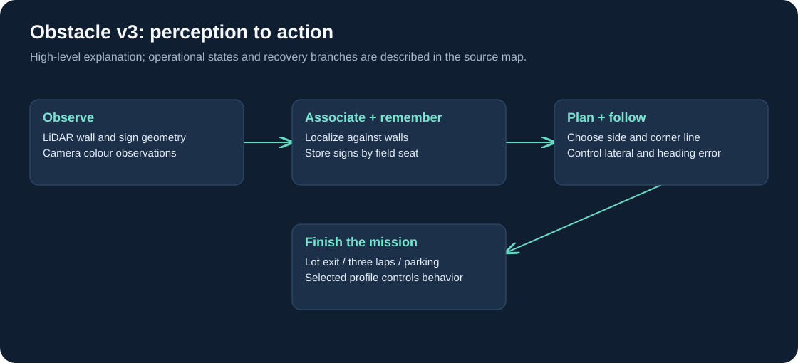

# Obstacle challenge — signs, trajectories and parking

## Geometric localization

Obstacle v3 uses LiDAR, gyro and camera. The [localizer](../src/robotek_obstacle_v3/robotek_obstacle_v3/localizer.py) fits observations to the known field geometry. This supplies a relationship between the car and the walls; it is not access to the simulator's true pose. The gyro provides turning information between observations, while the field model gives the sign seats and route progress used by the mission.

Localization depends on seeing enough useful walls and on matching sensor/frame conventions. A correct colour classifier cannot compensate for a badly oriented scan or an incorrect body model.

## Detecting and remembering traffic signs

The [perception stage](../src/robotek_obstacle_v3/robotek_obstacle_v3/perception.py) extracts candidate clusters from the LiDAR. Camera processing adds colour information; the mission associates observations with positions/seats and retains them across the route. Remembering a sign reduces the need to rediscover the same object in every lap, but makes association quality important: a wrong remembered colour can influence later decisions.

Red signs require passing on the right, green signs on the left. An unclassified cluster must not simply be treated as a known red or green sign. The mission includes observation/peek behavior and conservative offsets for unknown signs. Closely spaced signs and signs near corners challenge both association and available clearance.

The selected car profile includes a Wide-camera bearing calibration and HSV bounds. The red interval wraps the hue boundary. Tuning should include floor lines and backgrounds as negative examples, rather than maximizing only detections of clearly lit pillars.

## Route and corner construction

The mission builds a lateral line that holds the correct offset around each remembered sign and transitions between those offsets. Corner planning considers the signs on both adjacent straights. The implementation searches among straight–arc–straight corner options and uses the car geometry and clearance constraints.

Tracking combines local path geometry with lateral and heading error. This distinction is useful: the planner determines where the car should go, while the follower must achieve that path with a delayed steering mechanism and a minimum sustainable drive speed. A collision can originate in perception, planning or tracking; the logs should preserve enough information to identify which.

## Mission sequencing and recovery

The source connects setup, route execution and parking. The documented strategy wrapper pauses normal progress when required sensors are stale and exposes WAIT_SENSOR; a mission timeout leads to FAULT. Lower-level actions include turning, sign observation and departure/recovery, so one short sequence diagram cannot replace the source's conditional branches.

The front recovery checks a corridor along the requested arc rather than a fixed rectangular strip directly ahead. A sign that the car is turning away from should not automatically trigger the same response as an obstruction in its swept path. Recovery brakes and reverses with direction-dependent steering, with additional backing for repeated nearby triggers. These are recovery maneuvers to test, not proof that contacts never occur.

The lot-exit module handles departure when starting in the parking lot. Its parameters and steps are distinct from final parking. A complete Obstacle video must identify whether it starts in the lot, completes three laps and performs the final parking action.

## Three parking configurations

| Configuration | Source | Behavior and scope |
|---|---|---|
| Search-based parking | [park.py](../src/robotek_obstacle_v3/robotek_obstacle_v3/park.py), [parking_search.py](../src/robotek_obstacle_v3/robotek_obstacle_v3/parking_search.py) | Searches for maneuver sequences using the geometric model |
| Fixed-mode parking | [park_fixed.py](../src/robotek_obstacle_v3/robotek_obstacle_v3/park_fixed.py) | Uses a staged maneuver with feedback/thresholds |
| Car full-round profile | [car_picam_park_round.yaml](../src/robotek_obstacle_v3/config/car_picam_park_round.yaml) | Enables fixed partial parking plus calibrated finish pulses |

The car full-round profile sets parking true, park_mode 1, park_fixed_partial 1 and a finish-step string. It also records field-specific lot geometry: 0.31 m far limit and 0.3675 m lot length. The finishing pulses were calibrated for an observed car/field configuration and mirrored for the opposite direction. They have not been newly validated in this rebuild.

The default [car_picam.yaml](../src/robotek_obstacle_v3/config/car_picam.yaml) chiefly supplies camera and steering parameters. Merely running `car-run.sh obstacle` is not evidence that the full-round parking profile was selected. Archive the exact YAML and command for every parking result.

## Why minimum motor speed matters

The full-round profile includes a low nominal park_pulse_speed, but its example command also sets motor_min_rps to 2. A board minimum can dominate a lower speed request. Time-based pulses then depend on that effective physical speed, battery and turning load. Evaluate entry alignment, final clearance and body pose across repeated tests; do not equate a low number in the YAML with slow actual motion.

## Validation cases

Test both directions, signs near corners, adjacent signs of different colours, uncertain colour, sensor interruption, lot departure and final parking. Record wrong-side passages and moved signs separately from completed laps. Distinguish a successful parking-only test, a round without parking and a full round with parking. They answer different questions and should never share an unlabeled success count.
