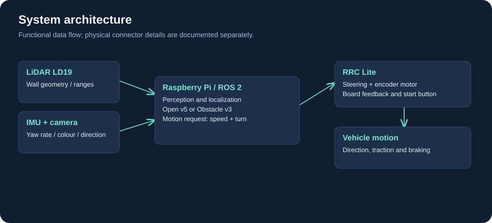
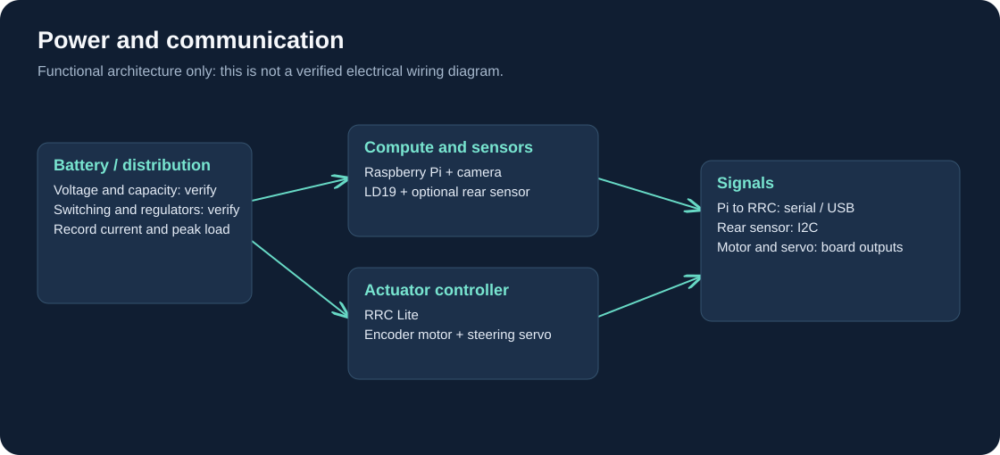

# System schemes and connection register

The drawings explain signal and power responsibilities. They deliberately do not invent connector pins or regulator wiring absent from the supplied evidence.

| Interface | Reference implementation | Physical detail to verify |
|---|---|---|
| Pi ↔ RRC Lite | Serial device alias /dev/rrc_lite | Cable, board revision and actual connection |
| RRC Lite → encoder motor | M2 selected by robot.yaml | Motor leads, encoder connection and direction |
| RRC Lite → steering | Board servo interface | Connector/channel and power path of the installed assembly |
| Pi ↔ LD19 | Driver and /dev/ldlidar alias | Serial adapter, power source and mounting orientation |
| Pi ↔ IMX708 | Picam driver path | Camera cable, orientation and selected pipeline |
| Pi ↔ VL53L0X | I2C bus 1, address 0x29 in baseline | Installed sensor, connector pins and rail voltage |
| Battery → loads | Functional architecture only | Chemistry, capacity, switch, protection and regulators |

The current installation must be photographed and traced before a pin-level electrical drawing can be marked verified. The old L298N diagram is a historical artifact, not a current wiring guide. See [power and sensing](../docs/03-power-and-sensor-architecture.md) for the design explanation.
